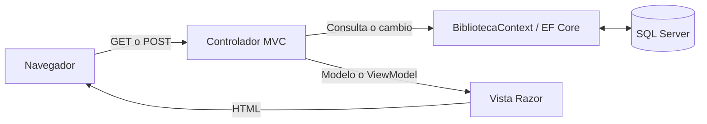
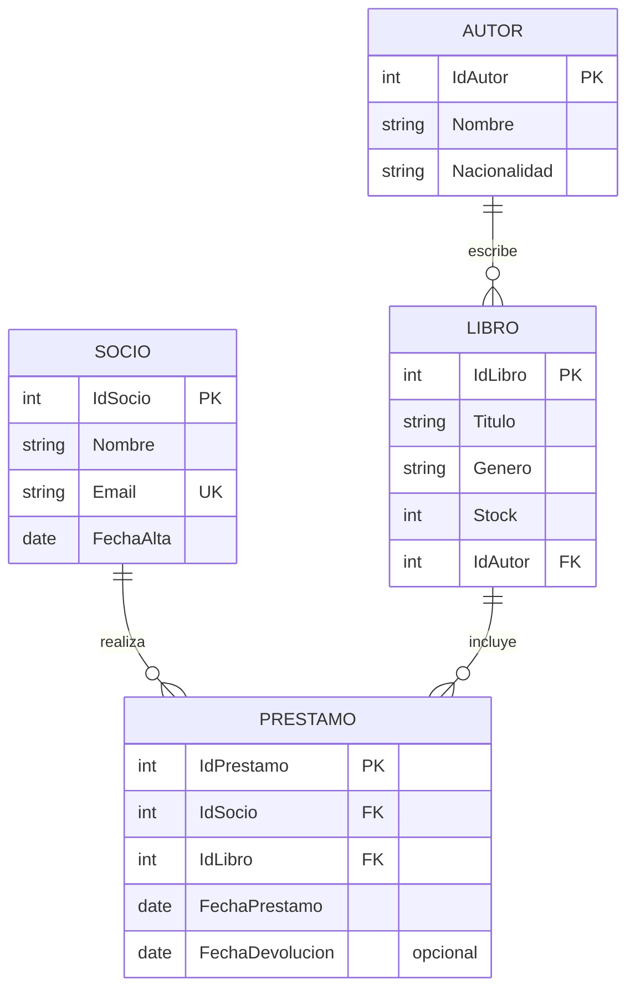

# Guía técnica de BibliotecaMVC

## 1. Problema, alcance y tecnologías

El sistema administra socios y catálogo de una biblioteca, registra préstamos y devoluciones y ofrece dos reportes. Tiene persistencia real en SQL Server. No hay login, roles, multas, reservas ni envío automático de correos implementados.

El proyecto declara `net9.0`, ASP.NET Core MVC y Entity Framework Core **9.0.10** con proveedor SQL Server. Las vistas usan Razor, Bootstrap y Tag Helpers. `wwwroot/js/site.js` conserva el contenido de plantilla; las reglas de negocio están en el servidor.

## 2. Arquitectura y recorrido de una petición



Ejemplo concreto: `GET /Prestamos/Create` carga socios y libros disponibles; la vista genera el formulario. Al enviarlo, MVC enlaza los valores con `PrestamoCreateViewModel`. El POST comprueba reglas y `ModelState`. Si hay errores, recarga las listas y devuelve la vista; si es válido, guarda y redirige al listado.

| Pieza | Función real | Archivo de referencia |
|---|---|---|
| Configuración | Servicios MVC, EF Core, SQL Server, cultura y rutas | [Program.cs](../../BibliotecaMVC/Program.cs) |
| Entidades | Datos que se guardan y relaciones de navegación | `BibliotecaMVC/Models/` |
| Contexto | Acceso a datos y configuración del modelo relacional | [BibliotecaContext.cs](../../BibliotecaMVC/Data/BibliotecaContext.cs) |
| Controladores | Atienden peticiones, validan y coordinan operaciones | `BibliotecaMVC/Controllers/` |
| ViewModels | Datos específicos de formularios, panel y reportes | `BibliotecaMVC/ViewModels/` |
| Vistas | Generan HTML con datos y errores | `BibliotecaMVC/Views/` |
| Migraciones | Pasos para construir o cambiar el esquema | `BibliotecaMVC/Migrations/` |
| Validación personalizada | Impide fechas posteriores al día del servidor | [NoFuturaAttribute.cs](../../BibliotecaMVC/Validations/NoFuturaAttribute.cs) |

Los controladores reciben `BibliotecaContext` en el constructor. `AddDbContext` permite resolver esa dependencia. No crean manualmente una conexión SQL en cada acción.

La ruta `{controller=Home}/{action=Index}/{id?}` hace que `/` abra `HomeController.Index`. La cultura se configura como `es-AR`; los reportes calculan “hoy” con `DateTime.Today` del equipo servidor.

## 3. Modelo de datos



Cada préstamo pertenece a un solo socio y un solo libro. Un socio y un libro pueden tener muchos préstamos a lo largo del tiempo. Cada libro tiene un autor en este modelo; no hay una relación de varios autores por libro.

`Stock` representa ejemplares disponibles, no el total adquirido. No existe una entidad `Ejemplar` para identificar físicamente cada copia. `FechaDevolucion` es nullable: `null` significa pendiente. `EstaPendiente` es una propiedad calculada a partir de esa fecha, sin un estado independiente que mantener.

### Restricciones en la base

- Índice único para `Socio.Email`.
- Claves foráneas para Libro → Autor y Prestamo → Socio/Libro.
- `CK_Libro_Stock`: `Stock >= 0`.
- `CK_Prestamo_Fechas`: devolución nula o mayor o igual que préstamo.
- `DeleteBehavior.Restrict`: impide borrar registros con dependencias.

El límite superior de stock, 1000, se valida en modelos/formularios; el CHECK de SQL solo exige que no sea negativo. La validación de fechas futuras y del alta del socio está en la aplicación, no en esos CHECK.

La migración inicial crea las cuatro tablas, índices, claves y restricciones, e inserta 5 autores, 8 libros, 5 socios y 11 préstamos. `HasData` define los datos iniciales; no es una carga que se ejecute y duplique en cada petición. Los préstamos pendientes ya están descontados del stock inicial.

## 4. Reglas de cada módulo

| Módulo | Operaciones y controles |
|---|---|
| Socios | CRUD, búsqueda por nombre/email, correo válido y único, alta no futura; no se elimina con préstamos registrados |
| Autores | CRUD, búsqueda por nombre/nacionalidad; no se elimina con libros asociados |
| Libros | CRUD, búsqueda por título o autor y filtro por género; autor existente; stock de formulario entre 0 y 1000; no se elimina con préstamos |
| Préstamos | Listado con búsqueda y estado, alta, devolución, edición de fechas y eliminación; actualiza stock según transición |
| Inicio | Cuenta socios, títulos, stock disponible y pendientes; lista los cinco préstamos más recientes |

### Alta de préstamo

1. Recibe IDs y fecha mediante `PrestamoCreateViewModel`.
2. Busca socio y libro; comprueba existencia.
3. Comprueba stock positivo.
4. Impide una fecha anterior al alta del socio; `[NoFutura]` impide una fecha futura.
5. Consulta si ese mismo socio ya tiene ese mismo libro sin devolver.
6. Si `ModelState` tiene errores, recarga los desplegables y muestra el formulario.
7. Agrega `Prestamo`, hace `libro.Stock--` y llama una vez a `SaveChangesAsync`.
8. Guarda un mensaje en `TempData` y redirige al listado.

El formulario solo ofrece libros con stock, y el servidor vuelve a comprobarlo. Ocultar opciones en la interfaz no sustituye la validación del POST.

### Transiciones de stock

| Operación | Cambio |
|---|---:|
| Crear préstamo | −1 |
| Pendiente → devuelto | +1 |
| Devuelto → pendiente mediante edición | −1, requiere stock positivo |
| Editar manteniendo el mismo estado | 0 |
| Eliminar préstamo pendiente | +1 |
| Eliminar préstamo devuelto | 0 |

Socio y libro no se modifican desde la edición del préstamo; el controlador vuelve a cargar el préstamo por ID. La devolución usa la fecha original guardada para comprobar que la devolución no la anteceda.

Guardar el préstamo y el cambio de stock en una llamada a `SaveChangesAsync` permite que SQL Server los confirme o revierta juntos mediante la transacción de guardado de EF Core. Esto **no resuelve por sí solo** la competencia entre dos peticiones que leyeron el mismo stock. [Documentación de transacciones de EF Core](https://learn.microsoft.com/en-us/ef/core/saving/transactions).

## 5. Reporte de pendientes — Matías

Referencia: [ReportesController.cs](../../BibliotecaMVC/Controllers/ReportesController.cs), acción `PrestamosPendientes`, y [su ViewModel](../../BibliotecaMVC/ViewModels/PrestamosPendientesViewModel.cs).

La consulta carga socio, libro y autor, exige `FechaDevolucion == null` y aplica filtros de socio y fechas. Ordena por fecha ascendente y luego por ID. Usa `AsNoTracking` y ejecuta con `ToListAsync`.

Después, en memoria:

```csharp
var dias = (hoy - p.FechaPrestamo.Date).Days;
// Está atrasado cuando supera el límite, no cuando lo iguala.
EstaAtrasado = dias > modelo.DiasPermitidos;
```

El filtro “Solo atrasados” se aplica a las filas calculadas. Cantidad, atrasados y promedio se obtienen de esas filas finales. Con lista vacía, el promedio es cero. El rango de días permitidos es 1 a 365; el valor predeterminado es 14. Un rango de fechas invertido se rechaza.

El enlace `mailto:` abre el programa de correo del usuario. La aplicación no envía mensajes automáticamente. El botón de devolución abre la confirmación; no cambia el stock por visitar el enlace.

## 6. Ranking de libros — Sebastián

Referencia: [ReportesController.cs](../../BibliotecaMVC/Controllers/ReportesController.cs), acción `LibrosMasPrestados`, y [su ViewModel](../../BibliotecaMVC/ViewModels/LibrosMasPrestadosViewModel.cs).

1. Si faltan fechas, usa 1 de enero del año actual y hoy.
2. Filtra `Prestamos` por fecha de préstamo, incluyendo ambos extremos, y opcionalmente género.
3. Agrupa por datos del libro con `GroupBy` y obtiene la cantidad con `Count`.
4. Ordena de mayor a menor cantidad y luego por título.
5. Materializa la consulta; calcula total, títulos distintos, género más pedido, puesto y porcentaje.
6. Aplica `Take(Top)` al final; 0 permite mostrar todos desde el selector.

`Porcentaje = CantidadPrestamos × 100.0 / TotalPrestamos`.

Los resúmenes y porcentajes incluyen todo el conjunto filtrado, antes de limitar las filas. Por eso las filas de un Top 5 pueden sumar menos de 100 %. El ranking incluye préstamos pendientes y devueltos; devolver no reduce la cantidad histórica. Un libro sin préstamos en el período no tiene grupo y no aparece. El stock es el actual, aunque se consulte un período pasado.

## 7. Interfaz, validación y seguridad implementada

- Razor combina HTML con expresiones C# como `@Model.Titulo`.
- `asp-for` enlaza nombre, tipo, valor y metadatos del campo; `asp-items` genera opciones; `asp-action` y `asp-controller` generan rutas.
- Los formularios compartidos `_Formulario` evitan repetir campos entre alta y edición.
- `_Layout` comparte menú, estilos, scripts y alertas. `_ViewStart` lo selecciona; `_ViewImports` importa namespaces y Tag Helpers.
- DataAnnotations y validaciones del controlador se reflejan en `ModelState`.
- `_ValidationScriptsPartial` carga validación de cliente para reglas compatibles. `NoFuturaAttribute` es una regla de servidor; no implementa un adaptador JavaScript propio. Algunas vistas agregan `max` de HTML para ayudar al usuario.
- Los POST de escritura llevan `[ValidateAntiForgeryToken]`. Los formularios con Form Tag Helper incorporan el token. Este control no sustituye usuarios ni permisos.
- `[Bind]` en socios/autores y el mapeo de ViewModels en libros/préstamos limitan qué valores del formulario se usan para guardar.
- Después de guardar se redirige al listado: patrón Post/Redirect/Get. `TempData` conserva el mensaje para mostrarlo después de la redirección.

## 8. Límites reales y mejoras defendibles

Estos puntos salen de la lectura del código; no fueron reproducidos mediante peticiones en ejecución.

| Límite observado | Ejemplo | Mejora propuesta |
|---|---|---|
| Sin autenticación ni roles | Las acciones de gestión no tienen `[Authorize]` | Identidad, login y permisos para bibliotecarios |
| Sin control explícito de concurrencia | Dos peticiones pueden leer simultáneamente el mismo stock y sobrescribir el mismo valor | Token `rowversion`, manejo de conflicto y actualización condicional/transacción según la operación |
| Reapertura no repite el control de duplicado pendiente | Se puede intentar quitar la devolución de un préstamo antiguo cuando ya existe otro pendiente para el mismo socio/libro | Revalidar el duplicado al reabrir y reforzar integridad en SQL |
| Edición del alta del socio no consulta su historial | Se puede intentar mover el alta después de préstamos existentes | Validación cruzada al editar el socio |
| El historial puede borrarse desde préstamos | Aunque se protegen socio y libro, existe eliminación física de préstamos | Baja lógica o auditoría si se requiere historial inalterable |
| No hay pruebas automatizadas incluidas | Las guías describen comprobaciones manuales | Pruebas de integración de préstamos, validaciones y stock |

Una respuesta adecuada es: “La regla está resuelta en este flujo; para cubrir también este caso necesitamos reforzar esta otra validación”. Evitar afirmar que todo caso de concurrencia o integridad está resuelto.

Para la mejora de concurrencia, consultar la [documentación oficial de EF Core](https://learn.microsoft.com/en-us/ef/core/saving/concurrency).
